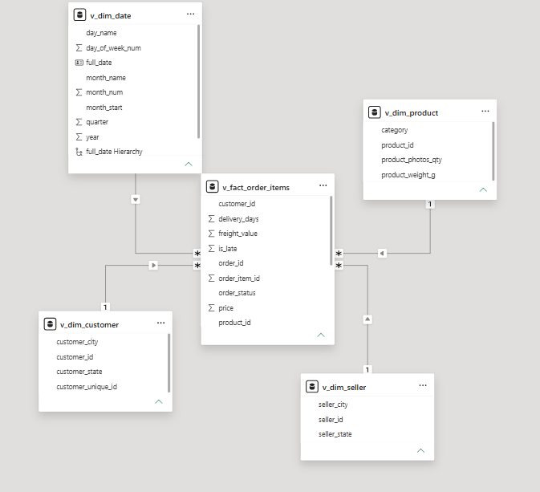
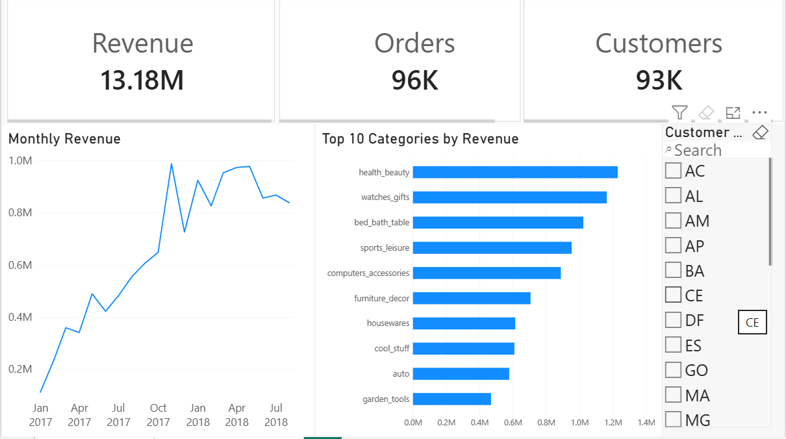
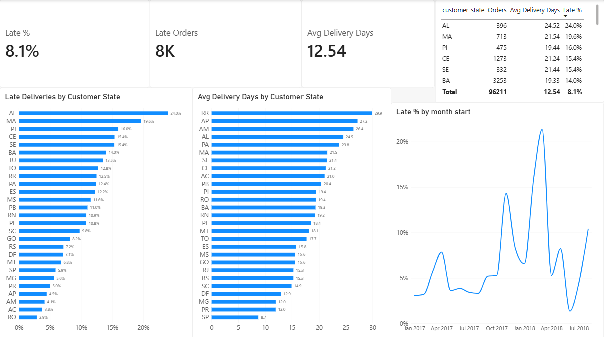

# Olist E-commerce Analysis: SQL and Power BI

Analysis of the Brazilian Olist marketplace dataset (about 99k orders, 2016-2018). Raw CSVs were loaded into PostgreSQL, validated, queried to answer eight business questions, and then modelled as a star schema for a two-page Power BI report.

Tools: PostgreSQL 16, pgAdmin 4, Power BI Desktop.

## Data

Source: [Olist Brazilian E-commerce dataset on Kaggle](https://www.kaggle.com/datasets/olistbr/brazilian-ecommerce). The CSVs are not included in this repository.

Seven tables are used: customers, sellers, products, orders, order items, order payments and the category name translation. Order volume is very low in the first and last months of the dataset, so time-based analysis is limited to January 2017 to August 2018.

Conventions used throughout: revenue is the sum of item price on delivered orders (freight excluded), in BRL. Delivery questions use delivered orders only. Customers are counted on `customer_unique_id`, because `customer_id` is generated per order.

## Repository contents

- `sql/01_schema.sql`: table definitions
- `sql/02_load.sql`: CSV load (psql `\copy`)
- `sql/03_checks.sql`: eight data quality checks
- `sql/04_analysis.sql`: eight business questions, with findings noted under each query
- `sql/05_views.sql`: fact and dimension views for Power BI
- `powerbi/olist_powerbi.pbix`: report (data is embedded)
- `images/`: screenshots of the model and report pages

## Data quality checks

- 775 orders have no line items, mostly unavailable or canceled.
- 8 delivered orders have no delivery date, and 6 canceled orders have one.
- 610 products have no category and 13 have a category missing from the translation table. These are handled with a left join, falling back to the Portuguese name and then "unknown".
- 96,096 unique customers placed 99,441 orders.
- Item totals and payment totals differ for 303 orders, so revenue is based on item prices.

## Findings

Revenue grew from about R$112k in January 2017 to R$0.83-0.98M per month in 2018. November 2017 was the peak (R$988k), followed by a 26% fall in December. The top 10 of 74 product categories account for 62% of revenue, led by health_beauty, watches_gifts and bed_bath_table.

Delivery performance varies widely by state. São Paulo is the fastest at 8.8 days with 5.9% of orders late. Alagoas has the highest late rate at 23.9%. Amazonas and Amapá have the longest delivery times (26-27 days) but a late rate of only about 4%, which may reflect longer estimated delivery dates; this was not tested.

Customer behaviour is dominated by one-time purchases. 97% of customers ordered once, and of customers acquired in 2017, between 0.1% and 0.7% returned in any given later month.

Credit card accounts for 78.5% of payment value (3.5 instalments on average) and boleto for 18%. Seller revenue is concentrated: the top 10% of sellers (297 of 2,970) generate 67% of revenue.

97% of orders reach delivery, with a median of 10.2 days from purchase. The carrier leg is the largest part (median 7.1 days). Boleto orders take over a day to be approved, compared with almost none for credit card orders.

## Data model

Star schema with one fact view at order-item grain (`v_fact_order_items`) and four dimensions: product, seller, customer and date. Relationships are one-to-many with filters flowing from dimension to fact.

The customer dimension is at `customer_id` grain (one row per order), since 39 customers appear with more than one state and picking one would be arbitrary. Distinct customers are counted on `customer_unique_id` using `CROSSFILTER` in the measure.

## Report

Sales overview: revenue, orders and customers, monthly revenue trend, top 10 categories and a state filter.

Delivery performance: late-delivery rate and average delivery days by state, and late rate by month. Both pages are filtered to January 2017 - August 2018, which accounts for small differences from the unfiltered SQL results.

## Notes on method

- Joining order items to payments multiplies rows when an order has several of each. Both tables were aggregated to order level before comparison.
- Percentages in SQL use `100.0` to avoid integer division.
- The median delivery time (10.2 days) is higher than the sum of the stage medians (8.9 days), as medians are not additive. Splitting approval time by payment type showed boleto as the main source of delay.

## Running the project

1. Download the dataset from Kaggle and place the CSVs in one folder.
2. Create a PostgreSQL database and run `sql/01_schema.sql`.
3. Update the folder path in `sql/02_load.sql` and run it in psql.
4. Run `03_checks.sql`, `04_analysis.sql` and `05_views.sql` with `SET search_path = olist;`.
5. Open the `.pbix` file. It does not need a database connection to display.

## Limitations

- Payments are analysed in SQL (Q6) but are not part of the Power BI model.
- Freight is excluded from revenue.
- Late-delivery rates spike around November 2017 and early 2018. The dataset does not contain enough information to explain why.
- Small groups (the Q5 cohorts, small states such as RR) are too small for firm conclusions.
